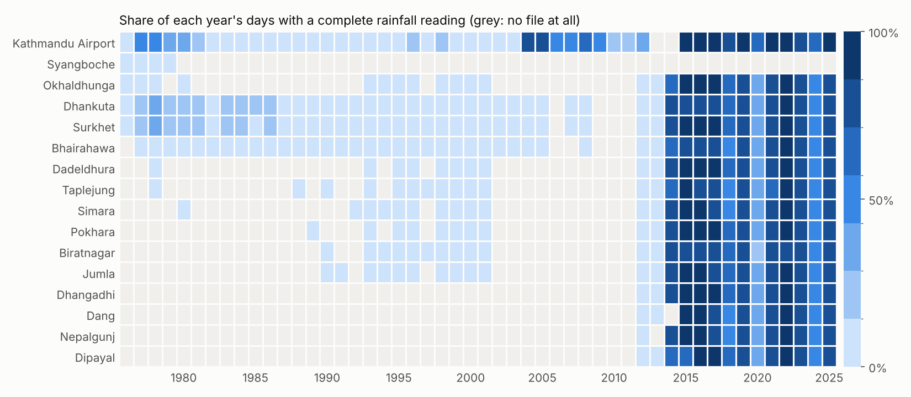
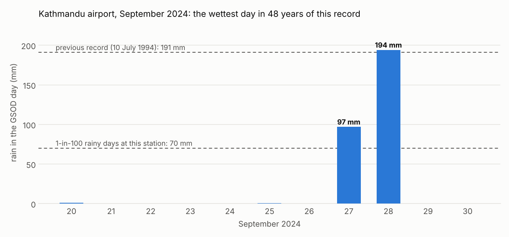
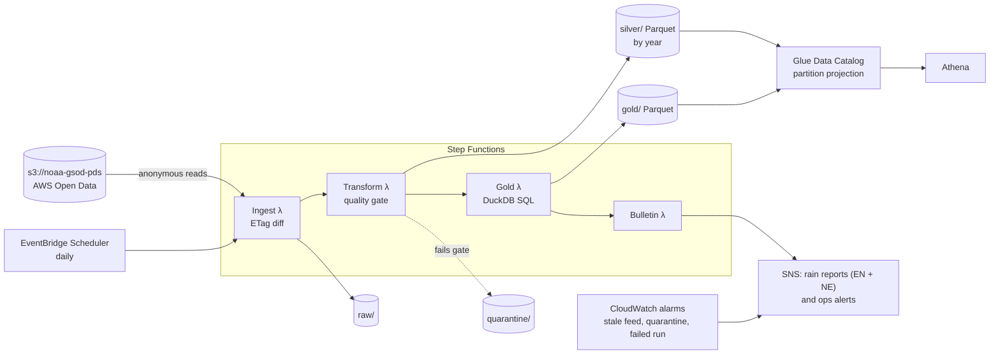

# Nepal Monsoon Rainfall Lakehouse: a monsoon rainfall lakehouse for Nepal on AWS

[](https://barsha-nepal-monsoon-lakehouse.onrender.com)

Barsha turns 50 years of public weather-station data for Nepal into a clean, queryable rainfall record. Every morning it tells disaster responders, reporters and insurers how unusual yesterday's rain was for each place. The data comes from NOAA's daily summaries on the AWS Open Data registry and lands in an S3 lakehouse (raw, silver, gold). A quality gate decides what gets published, Athena serves SQL, and a daily bulletin goes out in English and Nepali. It runs serverless for about **$1.20 a month**.

```text
$ python -m barsha bulletin --as-of 2024-09-28

[RED] Barsha rain report (Kathmandu Airport): 194 mm on 2024-09-28, very heavy rain. Wettest day in this
      station's record (previous highest 191 mm). 291 mm over 3 days: landslide and flood risk stays high.
      वर्षा प्रतिवेदन (काठमाडौं विमानस्थल): २०२४-०९-२८ मा १९४ मिमि, धेरै भारी वर्षा। यो स्टेशनको रेकर्डमै
      सबैभन्दा धेरै (पहिलेको अधिकतम १९१ मिमि)। ३ दिनमा २९१ मिमि: पहिरो र बाढीको जोखिम उच्च छ।
[RED] Barsha rain report (Dhankuta): 173 mm on 2024-09-28 ... Wettest day in this station's record.
[RED] Barsha rain report (Biratnagar): 170 mm on 2024-09-27 ... Wettest day in this station's record.
[RED] Barsha rain report (Okhaldhunga): 110 mm on 2024-09-28 ... Wettest day in this station's record.
[ORANGE] Barsha rain report (Bhairahawa): 194 mm on 2024-09-28 ...
```
*(Real output, replaying the morning after the September 2024 floods that hit the Kathmandu Valley. Thresholds use only the years before 2024, so this is what a live run would have said.)*

## The problem

Every monsoon, floods and landslides kill people in Nepal. After each storm the same questions come up: was this rain unusual for this place, has it happened before, which areas got the worst of it? Answering them takes a long, trustworthy rainfall record. The public one is full of traps:

- **Zeros that aren't zeros.** 4,599 station-days say `0.00` with a flag meaning "nothing was reported". Read naively, Kathmandu had **0 mm in the 2001, 2002 and 2003 monsoons**.
- **Gaps that hide on rainy days.** Of the days the archive leaves blank, 99.9% had rain in the station's weather codes. Dropping them makes every wet season look drier than it was.
- **Whole days missing.** On 10 and 12 August 2017, the peak of that year's Terai floods, one station out of fifteen has a row.
- **A feed that stops without saying so.** The public bucket hasn't had a new day since 24 August 2025. A pipeline that only reacts to new files reports "OK" every morning.

Barsha is the data engineering that makes this record safe to use: it ingests incrementally, keeps quality flags with the data, refuses to publish what it can't stand behind, and says out loud when the source goes quiet.

## What it finds in the real data

| | |
|---|---|
| Stations, period | 16 Nepal synoptic stations, 1976 to 24 Aug 2025 (409 files, 67,215 station-days) |
| Days with a complete 24-hour rainfall reading | 52,538 (78%) |
| Days whose `0.00` is really "not reported" | 4,599, kept as missing instead of dry |
| Station-monsoons complete enough (90%) to publish a total | **60 of 337**; the rest say why they're withheld |
| Red alert days (2014-2025) | 37, including station records on 28 Sep 2024 (Kathmandu, Dhankuta, Okhaldhunga, Biratnagar), 18-19 Oct 2021 (Dadeldhura, Dipayal, Dhangadhi) and 14-15 Aug 2014 (Surkhet, 427 mm) |
| Values held back as suspect | 1: Taplejung, 404 mm on 19 Apr 2018, with no neighbour above 17 mm |
| Source freshness today | **415 days stale**: operators are paged, the public isn't told it's dry |



Before 2013 most stations report rainfall on few days. From 2014 the network is much better, but still has holes, like 2020 at Kathmandu. Any total or trend built on this record without this context is wrong. The full breakdown is in [docs/DATA.md](docs/DATA.md).



## Architecture



| Layer | Choice | Why, in one line |
|---|---|---|
| Ingest | Lambda, `ListObjectsV2` + ETag manifest | Daily runs copy only changed files; re-runs change nothing |
| Raw | S3, versioned, one key per station-year | Every upstream revision is kept for 90 days as an audit trail |
| Silver | Parquet partitioned by year, whole partition rebuilt | Upstream changes whole files, so no MERGE or Iceberg is needed |
| Quality | Gate with block/fix severities, per-run results | A bad file can't replace the last good version |
| Gold | DuckDB SQL in Lambda, full rebuild in under a second | Same SQL on my laptop, in tests and in AWS |
| Catalog | Glue tables in CloudFormation, partition projection | No crawler, no `MSCK REPAIR`, schema reviewed like code |
| Query | Athena workgroup with a 1 GB scan cap | Pay per query, nothing idle |
| Orchestration | Step Functions + EventBridge Scheduler | Per-step retries and a failure branch for half a cent a month |

The reasoning, the decision records and the security model are in [docs/ARCHITECTURE.md](docs/ARCHITECTURE.md).

## Alternatives, failure modes and cost

- **[docs/ALTERNATIVES.md](docs/ALTERNATIVES.md)** compares each layer with the main alternatives (Glue Spark, Iceberg, Kinesis, MWAA, Redshift Serverless, crawlers, Glue Data Quality, dbt) and says when I'd switch.
- **[docs/FAILURE_MODES.md](docs/FAILURE_MODES.md)** covers what happens when the feed stops, a file is truncated, a gauge breaks, a step fails or a run is repeated, each with the test that checks it.
- **[docs/COST.md](docs/COST.md)**: about $1.20 a month, 90% of it CloudWatch metrics and alarms. MWAA alone would cost ~$358.

## Challenges and bugs

The full log, with causes and fixes, is in [docs/CHALLENGES_AND_BUGS.md](docs/CHALLENGES_AND_BUGS.md). The ones I learned most from:

1. **My outlier check called the 2014 Surkhet flood a sensor error.** A rule that only looked at one station flagged 427 mm as impossible. Now a spike is only suspect if no station within 200 km had heavy rain the day before, the day of or the day after.
2. **The feed had stopped and every run said OK.** "Nothing new arrived" and "nothing to do" are now different states, with an alarm that also fires when the metric goes missing.
3. **The second source was a copy of the first.** GHCN-Daily agreed with GSOD on all 6,086 Kathmandu days because it is built from GSOD. I checked lineage and dropped it instead of calling it validation.
4. **"1 in 100 rainy days" is not a "100-year" event.** My first Nepali text said the latter, which overstates the rarity a hundredfold.

## Try it live

**[https://barsha-nepal-monsoon-lakehouse.onrender.com](https://barsha-nepal-monsoon-lakehouse.onrender.com)**

Replay the daily bulletin for any day since 1977 (28 September 2024 is the Kathmandu flood), browse a station's monsoon totals year by year, and run SQL over the lake.

It runs on a free server that sleeps when nobody is using it, so the first visit can take a minute to wake up. Everything runs offline: no API keys, no cloud account.

To run the same page locally: `pip install -r requirements-app.txt` and then `streamlit run app.py`.

## Run it

Needs Python 3.12+. No AWS account needed: NOAA's bucket allows anonymous reads.

```bash
make setup && source .venv/bin/activate
make backfill        # every year since 1976 into ./lake (~1 minute)
make replay          # the bulletin for 28 September 2024
make daily           # what the scheduler runs: incremental, usually copies nothing
python -m barsha query "select * from monsoon_season where station_id = '44454099999' order by year desc limit 10"
make test            # 33 tests, no network needed
```

Deploying to AWS: [infra/README.md](infra/README.md). Example Athena queries: [sql/athena/](sql/athena/).

## Repository layout

```text
barsha/
  source.py        list and read upstream files (S3 anonymous, or a local mirror)
  ingest.py        bronze: ETag-diffed copy into raw/, manifest
  parse.py         GSOD CSV -> typed rows, metric units, precipitation quality
  quality.py       the gate: blocking and fixing checks
  transform.py     silver: rebuild a year partition, quarantine on failure
  sql/             gold models (DuckDB SQL), run in order
  gold.py          builds gold tables from silver
  alerts.py        the bulletin, in English and Nepali
  pipeline.py      the four stages wired together
  aws/handlers.py  Lambda entry points for Step Functions
infra/             SAM template (S3, Lambda, Step Functions, Glue, Athena, SNS, alarms, budget)
sql/athena/        analyst queries
scripts/           cost model, charts
tests/             33 tests, including the Lambdas against mocked S3 and SNS
docs/              data, architecture, alternatives, failure modes, cost, bugs
```

## Honest limits

- **It isn't an early-warning system.** GSOD arrives a day or two late. Nepal's Department of Hydrology and Meteorology issues the warnings; Barsha answers "how unusual was it" the next morning, and keeps the long record clean.
- **Fifteen stations is a thin network** for a country this mountainous. A storm between stations is missed, and the 200 km neighbour check is coarse.
- **The AWS stack is lint-checked and its handlers are tested against mocked AWS, but I haven't deployed it to an account yet.** The ingest code has run against the real NOAA bucket, and the full pipeline has run end to end on that data locally.

## Data

NOAA Global Surface Summary of the Day, via the [AWS Open Data registry](https://registry.opendata.aws/noaa-gsod/). Raw files are not committed; `make backfill` fetches them.

## License

MIT
