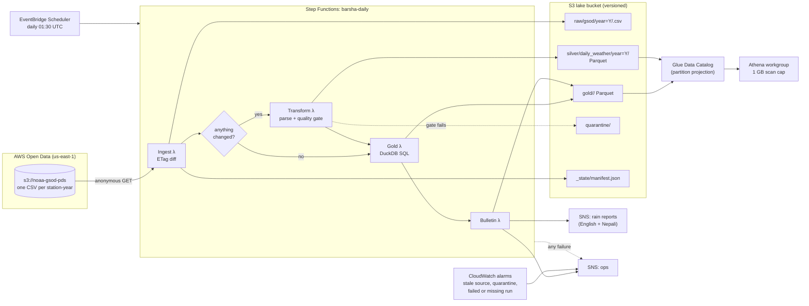

# Architecture

## The shape

## The four stages

| Stage | Reads | Writes | Unit of work | Idempotent because |
|---|---|---|---|---|
| **Ingest** | `ListObjectsV2` on `<year>/444` for this year and last; `GetObject` for changed files | `raw/gsod/year=Y/<station>.csv`, `_state/manifest.json` | one file | a file is copied only if its ETag differs from the manifest; the raw key is fixed per station-year |
| **Transform** | every raw file for a changed year | `silver/daily_weather/year=Y/data.parquet`, `quality/run=…/year=Y.json` | one year | the whole partition is rebuilt from its raw files and replaced in one PUT |
| **Gold** | all of silver (~67,000 rows, ~1.3 MB) | `gold/<table>/data.parquet` | everything | a full rebuild, under a second |
| **Bulletin** | `gold/rain_daily`, `gold/station_health` | `gold/bulletins/as_of=D/<run>.json`, SNS | one day | a re-run writes a second bulletin file under a new run id and republishes; nothing is double counted |

Every stage can be re-run on its own. If Transform fails after Ingest succeeded, the next day's run sees no ETag change and skips Transform; `python -m barsha rebuild --years 2025` (or the Lambda with `{"years": [2025]}`) rebuilds from raw without touching the source.

## Gold tables

| Table | Grain | What it answers |
|---|---|---|
| `rain_daily` | station × day | How much rain, of what quality, how it compares with this station's past, and the alert level |
| `monsoon_season` | station × year | June-September total, *only if* 90% complete; otherwise why not |
| `station_health` | station | Last report, days silent, completeness over the last year, share of rainy days with no amount |
| `station_dim` | station × version | Name, position, elevation over time (type 2 SCD) |
| `quality_summary` | station × quality × flag | How every day's precipitation was classified |

## Decisions

### ADR-001: A medallion lake on S3, rebuilt by partition, not a warehouse with MERGE

Upstream publishes whole station-year files and rewrites the current year's file as days arrive. The natural unit of change is therefore "a year", and the cheapest correct update is to rebuild that year's silver partition from its raw files and swap it in one PUT. There is no row-level upsert, so no MERGE, no Iceberg, no compaction and no vacuum. At 50 partitions of ~30 KB each, the small-file problem is real in principle and irrelevant in practice: Athena reads the whole silver table in well under a second.

*Switch point:* hourly data, or many more stations, would make per-year rewrites too coarse. Then I'd move silver to an Iceberg table and `MERGE` by `(station_id, obs_date)` from Athena or Glue.

### ADR-002: Lambda + DuckDB for transforms instead of Glue ETL

The whole dataset is 16 MB of CSV. A Glue Spark job spends longer starting than this pipeline spends working, and bills at least a minute of 2 DPUs per run. DuckDB inside Lambda runs the gold SQL in under a second and the same SQL runs on my laptop, which is where I develop and test it. The trade-off is the 15-minute and 10 GB Lambda ceilings. A full backfill uses about 15 seconds of CPU; the headroom is roughly a thousandfold.

*Switch point:* when a single run needs more than a few GB of memory, or when other teams need Spark, move Transform to Glue (Python shell first, Spark only if it's needed).

### ADR-003: Step Functions over MWAA or a single Lambda

One Lambda could run all four stages, but then a failure in Gold re-runs Ingest, retries are all-or-nothing, and there is no per-stage history. Step Functions gives per-stage retries with backoff, a failure branch that publishes to SNS, and a visual execution history, for about half a cent a month. MWAA (managed Airflow) would cost ~$350 a month idle for a four-step daily DAG.

### ADR-004: Partition projection instead of a Glue crawler

The schema is fixed and owned by this repo, so the Glue tables are declared in CloudFormation. Silver uses partition projection on `year`, so Athena computes partition paths itself: no crawler runs, no `MSCK REPAIR TABLE`, and a new year is queryable the moment its file lands. A crawler would also be free to "discover" a changed schema from a malformed upstream file, which is the opposite of what I want.

### ADR-005: Thresholds use only earlier years

`rain_daily` compares each day with the station's 99th and 99.9th percentile of rainy days and its previous maximum, computed **only from years before that day's year**. Using all years would leak the future: a record year would raise its own threshold and partly hide itself. It also means `python -m barsha bulletin --as-of 2024-09-28` shows exactly what a live run that morning would have shown.

A threshold needs about 300 earlier rainy days to mean anything; until then it is null and only the absolute categories apply.

### ADR-006: Data quality as a gate, not a report

Checks that mean the file can't be trusted (bad dates, duplicate station-days, a non-Nepal station, a year losing more than 10% of its rows, an unparseable file) **block** the year: silver keeps its last good version, the raw files are copied to `quarantine/`, the run ends `PARTIAL`, and `YearsQuarantined` alarms. Checks on individual values (temperature out of range, max below min, negative rain) null the value and count it. The result of every check is written to `quality/run=…/` so a person can see what happened.

I wrote these as plain pandas checks rather than Glue Data Quality rules so they run in tests and on a laptop. The rules map one-to-one onto DQDL (`IsUnique`, `ColumnValues ... between`, `RowCount`) if this moves to Glue.

### ADR-007: Region follows the data

The lake is in `us-east-1`, next to `noaa-gsod-pds`. The people who use Barsha are in Nepal, but they read emails and run Athena queries; neither needs low latency. Putting compute next to the source keeps every read in-region and uses the cheapest region. (My other project, Hawa, serves an API to people in Nepal and sits in Mumbai for the opposite reason.)

### ADR-008: One container image, four functions

pandas, pyarrow, DuckDB and numpy are ~320 MB installed, over Lambda's 250 MB zip limit. One arm64 image holds them all, and each function picks its handler with `ImageConfig.Command`. Graviton is about 20% cheaper per GB-second.

## Security

- The lake bucket blocks all public access, encrypts at rest (SSE-S3) and is versioned.
- The ingest function reads NOAA anonymously, so its role has no permission on any bucket but the lake.
- Each function's role is scoped to the lake bucket and, for Bulletin, to the two SNS topics.
- Athena enforces its workgroup settings: results encrypted, written to the lake, scans capped at 1 GB.
- Nothing in the data is personal. Lake Formation would add column- and row-level grants if Barsha were joined with, for example, household survey data; for public weather data, IAM and the bucket policy are enough.

## What I'd build next

1. **A second, independent source.** DHM's own station network is far denser than these 15 synoptic stations; its data would turn the spatial check from "any neighbour within 200 km" into a real comparison.
2. **Event tables.** Group consecutive alert days across neighbouring stations into one storm with a start, end, footprint and total.
3. **Data contracts in CI.** A schema test that runs against the newest upstream file every day, so a layout change fails a check before it fails the pipeline.
